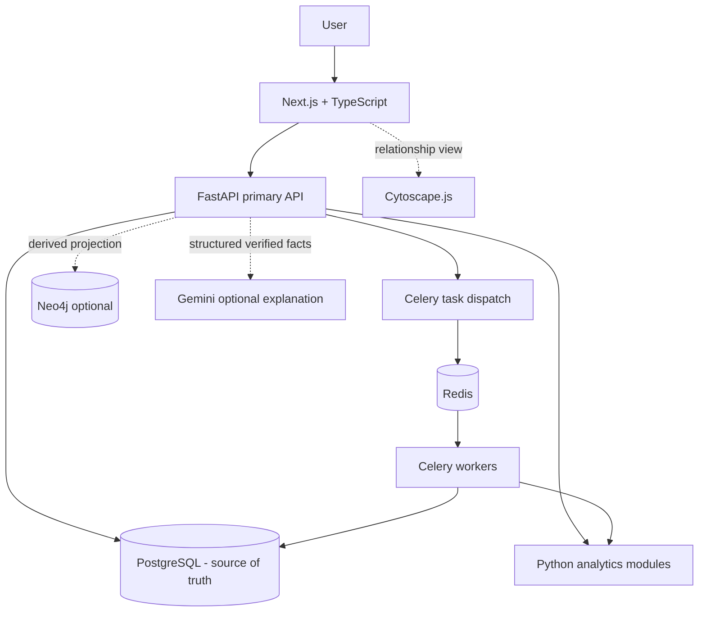

# 08 — Technical Architecture

## 1. Architecture goals

- One primary API and orchestration service.
- Python-first deterministic analytics.
- PostgreSQL as the only authoritative store for core business data.
- Optional graph projection and optional AI explanation.
- Reproducible local development using Docker Compose.
- Simple first vertical slice before background infrastructure is introduced.

## 2. Technology stack

| Layer | Technology | Architecture role |
|---|---|---|
| Web frontend | Next.js + TypeScript | UI and client-side interaction |
| Components/styling | Tailwind CSS + shadcn/ui | Accessible UI building blocks |
| Animation | Framer Motion | Optional micro-interactions |
| Charts | Apache ECharts | Financial and recurrence visualisation |
| Graph UI | Cytoscape.js | Relationship exploration |
| API | Python + FastAPI | Validation, business operations, orchestration |
| RDBMS | PostgreSQL | Source of truth |
| ORM | SQLAlchemy 2.0 | Persistence mapping and queries |
| Migrations | Alembic | Versioned schema changes |
| Graph DB | Neo4j | Optional, rebuildable projection |
| Background task system | Celery | Long-running imports and scheduled analytics |
| Broker/cache | Redis | Celery broker, cache, job state coordination |
| Dataframes | Pandas; optional Polars | Cleaning, grouping, transformations |
| Matching | RapidFuzz + regex + curated reference set | Merchant resolution |
| Statistics | NumPy, SciPy, Statsmodels | Recurrence and change analysis where appropriate |
| ML | Scikit-learn | Optional supporting signal only |
| LLM | Google Gemini API | Optional language explanation of structured results |
| Generator | Faker + custom seeded generators | Synthetic records |
| Auth | FastAPI-managed session for initial prototype | One coherent session authority |
| File parsers | CSV/XLSX/JSON first; PyMuPDF/pdfplumber optional | Import handling |
| OCR | PaddleOCR optional | Deferred image extraction |
| Storage | Local file storage; S3-compatible later | Uploaded synthetic source files and artifacts |
| Testing | Pytest + Playwright | Unit, API, and end-to-end validation |
| Runtime | Docker + Docker Compose | Local reproducibility |
| Observability | Sentry + OpenTelemetry optional | Errors, traces, performance |

The PDF describes Auth.js or FastAPI-compatible authentication as alternatives. For the initial prototype, choose **FastAPI-managed session authentication** to avoid two competing session systems. Use one demo workspace if multi-user authentication is not necessary for the first slice.

## 3. Logical architecture



## 4. Service boundaries

### 4.1 Next.js frontend

Responsibilities:
- Page layouts and navigation.
- Upload interaction and preview.
- Dashboard, list, detail, insight, cancellation, annual impact screens.
- ECharts and optional Cytoscape.js rendering.
- Form validation for immediate UX; backend remains authoritative.
- API client with typed request/response contracts.

Do not implement recurring detection or financial calculations in React components.

### 4.2 FastAPI backend

Suggested module boundaries:

```text
backend/
  app/
    main.py
    core/              # settings, logging, errors, security
    api/v1/             # routers and dependency wiring
    schemas/            # Pydantic request/response models
    models/             # SQLAlchemy ORM models
    repositories/       # database access
    services/           # use cases and orchestration
    analytics/          # pure Python detection/calculation modules
    matching/           # descriptor normalisation and merchant resolution
    ingestion/          # CSV/XLSX/JSON parsing and validation
    cancellation/       # playbook selection and simulated workflow
    graph/              # optional Neo4j projection adapter
    ai/                 # optional Gemini adapter
    tasks/              # Celery task definitions
    generators/         # synthetic data generation
    tests/
  alembic/
```

The implementation may adapt folder names to an existing repository, but keep responsibilities separated.

### 4.3 PostgreSQL

Stores all authoritative records. Use SQLAlchemy 2.0 and Alembic. Use explicit decimal/numeric types for amounts, ISO currency codes, timezone-aware timestamps, unique keys, indexes, and foreign-key constraints. Store original source rows or a safe row snapshot where required for evidence, while avoiding unnecessary raw file retention.

### 4.4 Analytics engine

Make core algorithms pure or service-independent where possible so they can be tested without HTTP, database, or LLM calls. Inputs and outputs should use validated data structures. Every detected object should include reason codes, evidence IDs, confidence, and algorithm version.

### 4.5 Celery + Redis

Introduce after a working synchronous import/detection flow exists, unless a phase explicitly authorises it earlier. Use job IDs and explicit states (`queued`, `started`, `succeeded`, `failed`, `cancelled` where relevant). Make tasks idempotent or safe to retry. Avoid putting full sensitive/source payloads in Redis; pass database IDs and minimal parameters.

### 4.6 Neo4j

Optional projection only. PostgreSQL remains authoritative. Build an idempotent projection job from PostgreSQL records. A Neo4j outage must not stop transaction ingestion, commitment detection, annual calculations, or cancellation guidance. Provide a rebuild path.

### 4.7 Gemini

Optional. Send only the minimum structured, synthetic insight fields required for wording. Prompt the model to describe supplied facts without adding facts. Validate response length/shape. If unavailable, use deterministic templates. Never ask Gemini to decide recurrence, calculate money, resolve an unrecognised merchant, or invent cancellation instructions.

## 5. Data flow — file ingestion

1. Next.js submits a file to FastAPI.
2. FastAPI validates extension, size, MIME/type signature where practical, encoding, and allowed schema.
3. A new Import record is created.
4. Parser converts rows into canonical staging structures while preserving raw descriptors and source-row numbers.
5. Validation separates accepted rows, duplicates, and rejected rows.
6. Accepted transactions/notifications are persisted in PostgreSQL with provenance.
7. Analytics runs synchronously for small demo loads or via Celery for larger loads.
8. Analytics creates/updates commitments and insight records with evidence references.
9. Optional Neo4j projection is refreshed.
10. Frontend polls or retrieves import/job status and refreshes data from APIs.

## 6. Data flow — merchant resolution

1. Preserve raw descriptor.
2. Create normalised descriptor (casefold, trim, standardise whitespace and safe separators; do not destroy meaningful tokens).
3. Exact canonical alias match.
4. Known regex/prefix match.
5. RapidFuzz candidate ranking within a bounded merchant set.
6. Apply thresholds and conflict rules.
7. Use cadence/amount/channel as corroborating evidence only, not as a stand-alone identity proof.
8. Store candidate, method, score, confidence band, alias/source, and review state.
9. Route ambiguous result to manual review.

Thresholds must be configurable and tested against positive and near-miss examples. A fuzzy score is not itself a probability.

## 7. Data flow — recurring detection

1. Select successful debit transactions.
2. Group by merchant identity candidate, currency, and relevant payment context.
3. Sort by transaction date.
4. Calculate intervals and amount behaviour.
5. Compare cadence candidates with tolerance windows.
6. Evaluate amount consistency or explainable variability.
7. Use mandate/notification evidence to strengthen classification.
8. Classify commitment type separately from recurrence cadence.
9. Create or update commitment with confidence, reason codes, linked transactions, and versioned detector metadata.
10. Place ambiguous clusters in review rather than force classification.

## 8. Insight and annualisation architecture

- Price increase: compare representative successful charge amounts within a stable merchant/cadence cluster; account for outliers and variable-amount bill categories; require sufficient history or explicit price-change notification.
- Trial conversion: link explicit trial event to a later successful paid debit; show uncertainty if merchant/time matching is ambiguous.
- Potentially unused: require an explicit usage coverage window; absence of events without coverage means “unknown”.
- Post-cancellation charge: require user-confirmed/notification cancellation event and later successful charge.
- Annualisation: use cadence-specific formulas and currency; show source window and assumptions; do not annualise uncertain irregular patterns as certain commitments.

## 9. Authentication and API access

Use a single FastAPI-managed session approach for the prototype. Prefer an HttpOnly, Secure-in-production, SameSite cookie; configure strict allowed origins; include CSRF protection for state-changing cookie-authenticated requests; store session identifiers safely; use short-lived demo sessions; do not put secrets in frontend code. If a single local demo workspace is used without sign-in, still isolate write operations and clearly document that it is demo-only. Do not add Auth.js concurrently without explicit architectural approval.

## 10. File storage

- Store uploads in a non-public local directory outside the static web root.
- Generate storage names; never trust a user-provided path.
- Apply size limits and file validation.
- Store import metadata and checksum in PostgreSQL.
- Remove temporary files after processing according to configured retention.
- Keep generated sample files clearly marked synthetic.
- Use S3-compatible storage only if hosted deployment requires it.

## 11. API inventory (initial proposal)

All routes are under `/api/v1` and use validated Pydantic schemas.

| Area | Method / route | Purpose |
|---|---|---|
| Health | `GET /health` | Liveness/readiness information, without secrets |
| Demo | `POST /demo/load` | Load fixed-seed synthetic demo records |
| Demo | `POST /demo/reset` | Reset only the demo workspace |
| Imports | `POST /imports` | Validate and create import |
| Imports | `GET /imports` | List imports |
| Imports | `GET /imports/{id}` | Import detail and counts |
| Imports | `GET /imports/{id}/status` | Import/background job status |
| Commitments | `GET /commitments` | Paginated/filterable list |
| Commitments | `GET /commitments/{id}` | Commitment details |
| Commitments | `PATCH /commitments/{id}` | User confirmation/correction fields only |
| Commitments | `GET /commitments/{id}/timeline` | Linked events/evidence |
| Transactions | `GET /transactions` | Paginated/filterable transactions |
| Transactions | `GET /transactions/{id}` | Transaction detail |
| Merchants | `GET /merchants` | Merchant reference list |
| Merchants | `POST /merchants/resolve` | Resolve/review descriptor candidate |
| Aliases | `POST /merchant-aliases` | Add alias (audited) |
| Insights | `GET /insights` | Filtered insight list |
| Insights | `GET /insights/price-changes` | Price-change insights |
| Insights | `GET /insights/trial-conversions` | Trial conversion insights |
| Insights | `GET /insights/unused` | Coverage-backed possible unused items |
| Insights | `GET /insights/post-cancellation` | Later charge after recorded cancellation |
| Analytics | `GET /analytics/overview` | Dashboard aggregates |
| Analytics | `GET /analytics/annual-impact` | Annual spend/savings estimates |
| Analytics | `GET /analytics/category-breakdown` | Category totals |
| Cancellation | `GET /commitments/{id}/cancellation-guide` | Mechanism-specific playbook |
| Cancellation | `POST /commitments/{id}/cancellation-attempts` | Record simulated attempt/status |
| Evidence | `POST /commitments/{id}/evidence` | Attach synthetic evidence metadata |
| Graph | `GET /graph/commitments/{id}` | Optional graph subgraph |

Routes may be refined while implementing, but document changes and keep frontend/client contracts in sync.

## 12. Error model

Use a consistent shape such as:

```json
{
  "error": {
    "code": "VALIDATION_ERROR",
    "message": "The file is missing a required date column.",
    "details": [{"field": "transaction_date", "issue": "missing_column"}],
    "request_id": "..."
  }
}
```

Do not expose stack traces, secrets, raw internal paths, or database credentials.

## 13. Deployment topology

Local development should use Docker Compose for required infrastructure (PostgreSQL; Redis when Celery is introduced; Neo4j only when graph phase is authorised). Next.js and FastAPI may run in containers or local development processes, but the documented path must be reproducible. Cloud hosting is optional. Never make AWS configuration a blocker for the hackathon MVP.

## 14. Version and dependency policy

Do not hardcode unverified “latest” versions into architecture documents. At implementation time, choose mutually compatible versions, lock dependencies, and document the actual resolved versions. Avoid installing optional packages until the phase requires them.
