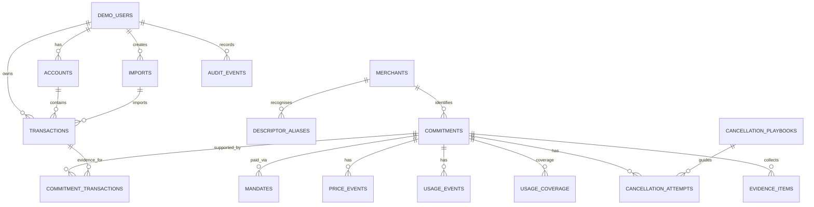

# 09 — Data Model

## 1. Data-model principles

- PostgreSQL is the authoritative data store.
- SQLAlchemy 2.0 models and Alembic migrations define the schema.
- Preserve raw source evidence; derived values are additional fields/records.
- Separate observed, inferred, and user-confirmed states.
- Store currency with every monetary amount; never assume all data is INR.
- Use `NUMERIC`/Decimal for money, not binary floating-point.
- Use timezone-aware timestamps for event times and explicit local billing dates where needed.
- Every inferred result should link to input evidence and an algorithm version.
- Synthetic records must carry a synthetic provenance marker.

## 2. Common conventions

- Primary keys: UUID unless a framework convention makes another stable identifier clearly preferable.
- Timestamps: `created_at`, `updated_at` where appropriate.
- Soft deletion: prefer explicit status/archival fields for business entities; do not silently erase evidence.
- JSON fields: only for bounded metadata or raw parser details; important relationships remain relational.
- Foreign keys: `ON DELETE RESTRICT` for evidence/history where practical; use cascade only for dependent staging records with a documented reset policy.

## 3. Core tables

### 3.1 `demo_users`

Purpose: demo workspace owner / synthetic user record.

Suggested fields:
- `id` UUID PK
- `display_name` nullable
- `workspace_key` unique synthetic workspace identifier
- `home_currency` ISO 4217 code
- `is_demo` boolean, must be true for this prototype
- `created_at`, `updated_at`

Do not store real identity, bank login, government ID, or payment credentials.

### 3.2 `accounts`

Purpose: synthetic source/account label, not a connected financial account.

Fields:
- `id` UUID PK
- `user_id` FK
- `label` e.g. “Synthetic Main Account”
- `account_type` enum: bank_statement, card_statement, wallet_export, other
- `institution_label` nullable fictional label
- `masked_reference` nullable synthetic-only display string
- `currency` ISO code
- `is_synthetic` boolean true

No actual account numbers, card numbers, UPI IDs, or credentials.

### 3.3 `imports`

Purpose: file and ingestion provenance.

Fields:
- `id` UUID PK
- `user_id` FK
- `account_id` nullable FK
- `filename_display` sanitised original display name
- `storage_key` generated internal key
- `file_type` enum: csv, xlsx, json, pdf_optional
- `checksum_sha256`
- `status` enum: uploaded, validating, queued, processing, succeeded, partial, failed
- `row_count`, `accepted_count`, `rejected_count`, `duplicate_count`
- `synthetic_confirmed` boolean true
- `source_label` enum: synthetic_upload, built_in_demo
- `error_summary` nullable
- `created_at`, `finished_at`

### 3.4 `transactions`

Purpose: observed debit/credit record parsed from synthetic source.

Fields:
- `id` UUID PK
- `user_id` FK
- `account_id` nullable FK
- `import_id` nullable FK
- `external_synthetic_id` stable synthetic source identifier
- `transaction_date` date or timezone-aware timestamp according to source precision
- `posted_at` nullable timestamp
- `raw_descriptor` text, immutable after ingestion
- `normalised_descriptor` text
- `amount` NUMERIC(18,2), signed or paired with direction (choose one consistent convention)
- `currency` ISO code
- `direction` enum: debit, credit
- `transaction_status` enum: successful, pending, failed, reversed, unknown
- `payment_channel` enum/string: upi, card, bank_transfer, app_store, wallet, unknown
- `payment_reference` synthetic reference only
- `source_row_number` nullable integer
- `raw_source_snapshot` bounded JSON, optional
- `is_synthetic` boolean true
- `created_at`

Constraints/indexes:
- Unique `(user_id, external_synthetic_id)` where stable ID exists.
- Index `(user_id, transaction_date)`, `(user_id, normalised_descriptor)`, `(user_id, currency, direction)`.
- Do not use amount alone as an idempotency key.

### 3.5 `payment_notifications`

Fields:
- `id` UUID PK
- `user_id` FK
- `import_id` nullable FK
- `external_synthetic_id` unique per user/source
- `event_timestamp` timezone-aware
- `event_type` enum: payment_success, payment_failed, trial_started, subscription_cancelled, mandate_created, mandate_updated, mandate_paused, mandate_revoked, price_changed, usage_event_optional
- `merchant_hint` raw text
- `amount` nullable NUMERIC(18,2)
- `currency` nullable ISO code
- `payment_mechanism` nullable enum
- `mandate_external_ref` nullable synthetic identifier
- `message_text` synthetic text
- `is_synthetic` boolean true

### 3.6 `merchants`

Fields:
- `id` UUID PK
- `canonical_name`
- `category` enum/string: entertainment, productivity, health_fitness, utilities, insurance, finance_loan, shopping, education, cloud_software, other
- `commitment_type_default` nullable
- `website_url` nullable, only if intentionally verified and approved for display
- `support_url` nullable, must have source and verification metadata before user-facing use
- `is_fictional_demo_merchant` boolean
- `reference_source` text nullable
- `verified_at` nullable date
- `created_at`, `updated_at`

Do not fabricate merchant websites or support channels. Use fictional names for most demo entities.

### 3.7 `descriptor_aliases`

Fields:
- `id` UUID PK
- `merchant_id` FK
- `alias_text`
- `normalised_alias`
- `matcher_type` enum: exact, prefix, regex, token_pattern
- `pattern` text
- `confidence_band` enum: high, medium, low
- `reference_source` text
- `verified_at` nullable date
- `is_active` boolean
- `created_at`

Unique active alias/pattern policy must avoid collisions; conflicts go to manual review.

### 3.8 `commitments`

Purpose: inferred or user-confirmed recurring obligation.

Fields:
- `id` UUID PK
- `user_id` FK
- `merchant_id` nullable FK
- `display_name`
- `commitment_type` enum: subscription, membership, utility, insurance, loan_emi, other_recurring, needs_review
- `cadence` enum: weekly, fortnightly, monthly, quarterly, annual, variable_monthly, irregular, unknown
- `status` enum: candidate, active, user_confirmed, review_required, marked_not_recurring, ended_user_recorded
- `currency` ISO code
- `representative_amount` nullable NUMERIC(18,2)
- `amount_min` nullable NUMERIC(18,2)
- `amount_max` nullable NUMERIC(18,2)
- `first_seen_at`, `last_seen_at`
- `next_expected_date` nullable; calculated estimate only
- `annualised_amount` nullable NUMERIC(18,2)
- `annualisation_method` nullable text/code
- `confidence_score` nullable numeric or bounded score (document that it is not a probability unless calibrated)
- `confidence_band` enum: high, medium, low
- `detection_reason_codes` JSON/list or related table
- `detector_version`
- `user_decision` nullable enum: confirmed, corrected, not_recurring, still_useful, no_longer_used
- `user_decision_at` nullable
- `created_at`, `updated_at`

### 3.9 `commitment_transactions`

Purpose: many-to-many evidence relation between commitments and transactions.

Fields:
- `commitment_id` FK
- `transaction_id` FK
- `relationship_role` enum: recurrence_evidence, amount_change_evidence, post_cancellation_charge, excluded_candidate
- `match_confidence`
- `reason`
- Composite PK or unique `(commitment_id, transaction_id, relationship_role)`.

### 3.10 `mandates`

Fields:
- `id` UUID PK
- `user_id` FK
- `commitment_id` nullable FK
- `merchant_id` nullable FK
- `external_synthetic_id` unique per user
- `mechanism` enum: upi_autopay, card_recurring, app_store, direct_debit, bank_instruction, other, unknown
- `status_observed` enum: active, paused, revoked, expired, unknown
- `maximum_amount` nullable NUMERIC(18,2)
- `currency` nullable ISO code
- `frequency_description` nullable text
- `start_date`, `end_date` nullable
- `source_notification_id` nullable FK
- `is_synthetic` true

Mandate status is an observed synthetic state, not a real provider status.

### 3.11 `price_events`

Fields:
- `id` UUID PK
- `commitment_id` FK
- `event_type` enum: amount_increase, amount_decrease, trial_to_paid, promotional_period_end, cadence_change, mandate_limit_exceeded, needs_review
- `previous_amount` nullable NUMERIC(18,2)
- `new_amount` nullable NUMERIC(18,2)
- `currency` nullable ISO code
- `percentage_change` nullable NUMERIC(9,4)
- `effective_or_detected_at`
- `confidence_band`
- `explanation`
- `evidence_transaction_ids` relational evidence links or join table
- `detector_version`
- `created_at`

### 3.12 `usage_events`

Fields:
- `id` UUID PK
- `user_id` FK
- `commitment_id` nullable FK
- `merchant_id` nullable FK
- `event_type` enum: app_open, streaming_session, gym_checkin, cloud_activity, user_confirmed_use, other
- `event_at`
- `source_label` synthetic source name
- `coverage_group` nullable identifier
- `is_synthetic` true

Use an additional usage coverage table or explicit metadata if the system needs to state a covered time interval with zero events. A missing event alone does not prove zero usage.

### 3.13 `usage_coverage` (recommended)

Fields:
- `id` UUID PK
- `user_id` FK
- `commitment_id` FK
- `source_label`
- `coverage_start`, `coverage_end`
- `coverage_complete` boolean
- `coverage_notes`
- `is_synthetic` true

### 3.14 `cancellation_playbooks`

Fields:
- `id` UUID PK
- `merchant_id` nullable FK
- `mechanism` enum
- `region_code` nullable
- `title`
- `steps` structured JSON with ordered step IDs, text, caution, and required/optional flags
- `escalation_steps` structured JSON
- `source_url` nullable
- `source_description` nullable
- `verified_at` nullable
- `verification_status` enum: verified, generic_mechanism_guidance, needs_review
- `version`
- `is_active`

Generic mechanism guidance must be clearly labelled. Merchant-specific instructions require reliable source provenance.

### 3.15 `cancellation_attempts`

Fields:
- `id` UUID PK
- `user_id` FK
- `commitment_id` FK
- `playbook_id` FK
- `status` enum: not_started, reviewed, request_recorded, response_received, user_recorded_cancelled, mandate_paused_recorded, mandate_revoked_recorded, further_charge_observed, closed
- `started_at`, `updated_at`, `closed_at` nullable
- `user_notes` bounded text
- `external_reference_synthetic` nullable
- `simulation_only` true

Never represent this record as proof that an external merchant or provider performed an action.

### 3.16 `evidence_items`

Fields:
- `id` UUID PK
- `user_id` FK
- `commitment_id` nullable FK
- `transaction_id` nullable FK
- `notification_id` nullable FK
- `price_event_id` nullable FK
- `cancellation_attempt_id` nullable FK
- `evidence_type` enum: transaction, notification, usage_coverage, user_confirmation, cancellation_note, synthetic_attachment, other
- `observed_at`
- `description`
- `source_reference`
- `is_synthetic` true
- `created_at`

### 3.17 `manual_review_items`

Fields:
- `id` UUID PK
- `user_id` FK
- `item_type` enum: merchant_match, recurring_cluster, price_event, usage_signal, other
- `candidate_payload` bounded JSON or linked record IDs
- `reason_code`
- `status` enum: open, accepted, corrected, dismissed
- `reviewed_by` nullable demo user reference
- `reviewed_at` nullable
- `decision_notes`

### 3.18 `audit_events`

Fields:
- `id` UUID PK
- `user_id` FK nullable for system events
- `entity_type`, `entity_id`
- `action`
- `before_summary`, `after_summary` bounded JSON with no secrets
- `actor_type` enum: user, system, seed_generator
- `created_at`

## 4. Key relationships



## 5. Neo4j projection model (optional)

Possible nodes:
- `User`
- `Account`
- `Transaction`
- `RawDescriptor`
- `Merchant`
- `DescriptorAlias`
- `Commitment`
- `Mandate`
- `PriceEvent`
- `CancellationPath`
- `UsageSignal`

Possible relationships:

```cypher
(User)-[:HAS_ACCOUNT]->(Account)
(Account)-[:SENT]->(Transaction)
(Transaction)-[:HAS_DESCRIPTOR]->(RawDescriptor)
(RawDescriptor)-[:RESOLVES_TO]->(Merchant)
(Transaction)-[:PART_OF]->(Commitment)
(Commitment)-[:PAID_VIA]->(Mandate)
(Mandate)-[:ISSUED_BY]->(Merchant)
(Commitment)-[:HAS_PRICE_EVENT]->(PriceEvent)
(Commitment)-[:HAS_USAGE]->(UsageSignal)
(Merchant)-[:HAS_CANCELLATION_PATH]->(CancellationPath)
(PriceEvent)-[:TRIGGERED_BY]->(Transaction)
```

Add stable PostgreSQL IDs as graph properties. Projection sync must be idempotent and rebuildable. Never write core truth only to Neo4j.

## 6. Data lifecycle and integrity

- Imports preserve file checksum, source-row provenance, and validation results.
- Transactions are immutable source observations; corrections create audit events and derived normalised values.
- A detector rerun can update an inference while retaining detector version and evidence history.
- User confirmation is stored separately from algorithmic status.
- Demo reset affects only the dedicated synthetic workspace.
- Currency must match before transactions are grouped or amounts are compared.
- Use database constraints for uniqueness and valid state transitions where practical.
